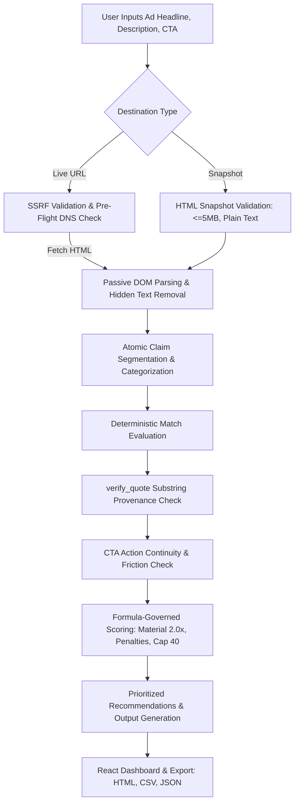

# PS-03 Ad-to-Landing-Page Message Match Auditor

A deterministic full-stack web application that audits continuity and message match between digital advertisements and landing pages. Built for hackathon evaluation with **100% deterministic quote verification, explainable mathematical scoring, and zero hallucinated findings**.

---

## 🏗️ Architecture & Workflow



---

## 🔒 Non-Negotiable Engineering Rules

| Rule | Enforcement Strategy |
|---|---|
| **1. Never Invent Content** | Every displayed quote must pass deterministic `verify_quote()` against extracted source text. If verification fails, it strictly outputs: `"No verified evidence quote available."` |
| **2. Honest Error Handling** | Never claims a page was analyzed if fetching or extraction failed. Returns structured error object with `overall_score: null` and no findings. |
| **3. Deterministic Statuses** | `Supported`, `Partial Match`, `Not Found`, `Contradicted`, `Uncertain`. **Absence of evidence = `Not Found`**, never `Contradicted`. Similarity alone never = `Supported` if key entities disagree. |
| **4. Null vs 0.0 Score** | Incomplete analyses strictly yield `null` (`"Score unavailable"`), distinguished from `0.0`. |
| **5. Strict Security** | Pre-flight SSRF check blocks loopback, private subnets, cloud metadata (`169.254.169.254`), and IPv4-mapped IPv6. Uploaded snapshots are passively parsed without executing JS. |
| **6. Synthetic Demo Labeling** | All 7 demonstration presets are explicitly labeled `"Synthetic example"`. |
| **7. Modular Architecture** | Decoupled `api/`, `schemas/`, `services/`, and `core/` modules. |
| **8. Real Tested Code** | Full pytest suite (32 tests) verifying security, extraction, matching, and scoring. |

---

## 📊 Scoring Formula Summary

$$\text{Base Score} = \left( \frac{\max\left(0, \sum \text{Status Value}_i \times \text{Weight}_i\right)}{\sum \text{Max Points}_i} \right) \times 100$$

- **Status Values**: Supported = `1.0`, Partial Match = `0.5`, Uncertain = `0.25`, Not Found = `0.0`, Contradicted = `-0.5`
- **Weights**: Material claims (`Offer / Pricing`, `Headline`) = `2.0x`, Standard claims = `1.0x`
- **Penalties**: `-15.0 pts` per contradicted claim, `-10.0 pts` for CTA action friction
- **Hard Cap 40**: If any claim is `Contradicted`, the final score is strictly capped at `40.0`.

*See [docs/SCORING.md](docs/SCORING.md) for full mathematical details.*

---

## 🔌 API Endpoints

| Method | Endpoint | Description |
|---|---|---|
| `GET` | `/api/health` | Health status |
| `GET` | `/api/demo` | List all 7 synthetic scenarios |
| `GET` | `/api/demo/{id}` | Retrieve scenario details and raw HTML |
| `POST` | `/api/audit/url` | Audit ad against live URL (SSRF-guarded) |
| `POST` | `/api/audit/snapshot` | Audit ad against uploaded HTML snapshot (multipart) |
| `POST` | `/api/export/{format}` | Export report as `csv` (formula-escaped), `html` (standalone), `json`, or `markdown` |

---

## 🧪 7 Pre-Configured Synthetic Scenarios

Each scenario runs through the **real backend pipeline** using HTML files stored in `sample_data/pages/`:

1. **Scenario 1: Strong Match** (`sample_data/pages/scenario_1_strong_match.html`): High-converting benchmark where headline, 99.9% uptime, 14-day free trial, and primary CTA match verbatim.
2. **Scenario 2: Missing Material Promise** (`sample_data/pages/scenario_2_missing_material.html`): Ad promises 50% Off and Free Domain, but page omits them.
3. **Scenario 3: Partial Support** (`sample_data/pages/scenario_3_partial_support.html`): Security topic present, but specific metrics (1,000+ endpoints) are unconfirmed.
4. **Scenario 4: Explicit Contradiction** (`sample_data/pages/scenario_4_contradiction.html`): Ad promises free forever; page states paid subscription only & no refunds.
5. **Scenario 5: Inaccessible Website** (`sample_data/pages/scenario_5_empty_shell.html`): JS-only client-side empty shell; triggers `insufficient_content` error, null score, no findings.
6. **Scenario 6: CTA Mismatch** (`sample_data/pages/scenario_6_cta_mismatch.html`): Ad promises instant self-serve trial; page primary action demands gated sales consultation.
7. **Scenario 7: Uncertain Evidence** (`sample_data/pages/scenario_7_uncertain.html`): Vague conceptual buzzwords where claims can neither be confirmed nor refuted.

---

## 🚀 Running Locally (Windows PowerShell)

### Prerequisites
- Python 3.10+
- Node.js v18+ and npm

### 1. Backend Server
```powershell
# In terminal 1 (root directory):
pip install -r backend/requirements.txt
python -m uvicorn backend.app.main:app --host 127.0.0.1 --port 8000 --reload
```
API runs at: `http://127.0.0.1:8000` (Docs available at `/docs`)

### 2. Frontend Development Server
```powershell
# In terminal 2:
cd frontend
npm install
npm run dev -- --host 127.0.0.1 --port 5173
```
Frontend runs at: `http://127.0.0.1:5173/`

### 3. Automated Backend Tests
```powershell
python -m pytest -v
```

### 4. Frontend Type Check & Production Build
```powershell
cd frontend
npx tsc --noEmit
npm run build
```

---

## ⚠️ Known Limitations

1. **Client-Side SPA Shells**: Pages that render 100% of their text via client-side JavaScript without server-side rendering (SSR) cannot be fully analyzed via passive HTTP extraction. The app detects this and returns a clear `insufficient_content` error instead of guessing.
2. **Anti-Bot WAFs & CAPTCHAs**: Sites protected by Cloudflare Bot Management or perimeter challenges that block standard automated fetchers will return HTTP 403/503. Use the **Upload Snapshot** feature to audit such pages reliably.
3. **Residual DNS Rebinding Window**: Addressed in [docs/SECURITY.md](docs/SECURITY.md). Production deployments should enforce egress network firewalls and IP-pinning transport layers.
